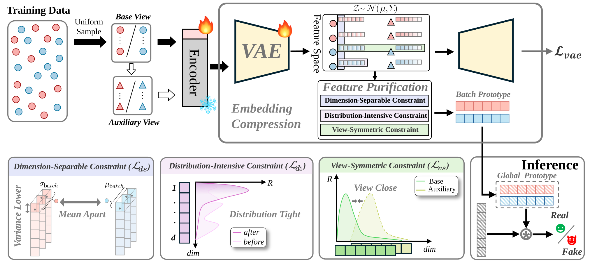

<div align="center">

# FePreR2

**Few and Precise: Dimension-Wise Representation Reshaping for Generalizable AI-Generated Image Detection**

Official PyTorch implementation (under review at *Pattern Recognition*).

[](https://github.com/Gadfly-Yang/FePre2/actions/workflows/ci.yml)
[](LICENSE)
[](README.md#installation)

</div>

<div align="center">
  
</div>

## ✨ TL;DR

**FePreR2** reshapes the representation of a frozen vision foundation model
(CLIP) along *dimensions* rather than layers. A lightweight LoRA adapter, a
VAE bottleneck, and a prototype classifier are supervised by three
**DDS-guided** constraints — dimension-separable, distribution-intensive, and
view-symmetric — so that a compact set of dimensions carries transferable
real/fake evidence. With **<1% trainable parameters**, FePreR2 ranks **first
on 4 of 6 cross-dataset targets** on DeepfakeBench and achieves **99.13 mAP**
across 19 generators on UniversalFakeDetect.

## 📢 News

- **[2026/10]** Code and pretrained checkpoints released.

## 🔍 Overview

- **Backbone:** frozen CLIP visual encoder (ViT-L/14 deep CLS features for
  deepfake detection; L12 CLS features for synthetic image detection —
  intermediate layers preserve generator traces with less semantic dominance).
- **Reshaping head:** LoRA (r=2, α=32, dropout 0.25) → VAE bottleneck
  (hidden 512, latent 128) → prototype classifier with momentum 0.99.
- **DDS-guided objectives:** the Dimension Discriminability Score (Fisher
  discriminant ratio) steers three losses:
  - `L_ds` — dimension-separable (weight 1.0): each key dimension separates
    real/fake on its own;
  - `L_di` — distribution-intensive (weight 0.5): real/fake statistics are
    separated under DDS-weighted sampling temperatures (0.1 / 0.5);
  - `L_vs` — view-symmetric (weight 0.1): paired views share the same
    reshaping under identical reference transforms.

## 🏆 Main Results

**Deepfake image detection** — trained on FF++ (c23), AUC reported (paper Table 1):

| Method | Venue | FF++ | DFD | CDFv1 | CDFv2 | DFDC | DFDCP | UADFV |
| :--- | :--- | :---: | :---: | :---: | :---: | :---: | :---: | :---: |
| UCF | ICCV'23 | 0.971 | 0.807 | 0.779 | 0.753 | 0.719 | 0.759 | 0.953 |
| LSDA | CVPR'24 | 0.948 | - | 0.847 | 0.814 | 0.729 | 0.789 | 0.952 |
| FreDebias | CVPR'25 | 0.975 | 0.868 | 0.875 | 0.836 | 0.741 | 0.824 | - |
| CRDA | AAAI'26 | 0.937 | - | 0.901 | 0.854 | 0.743 | 0.797 | 0.957 |
| **FePreR2 (Ours)** | - | **0.980** | **0.938** | **0.929** | **0.909** | 0.841 | **0.884** | **0.974** |

Video-level AUC (same protocol): **0.999** (FF++), **0.970** (DFD), **0.981**
(CDFv1), **0.971** (CDFv2), **0.868** (DFDC), **0.919** (DFDCP), **0.987**
(UADFV) — first on 4 of 6 cross-dataset targets at both levels.

**Synthetic image detection** — trained on ProGAN, AP per generator family and
mAP over all 19 generators (paper Table 2):

| Method | Venue | GAN | Low-level | Perceptual | Diffusion | **mAP** |
| :--- | :--- | :---: | :---: | :---: | :---: | :---: |
| UniFD | CVPR'23 | 99.6 | 78.5 | 79.2 | 95.9 | 90.14 |
| LGrad | CVPR'23 | 95.7 | 59.4 | 69.6 | 97.3 | 86.35 |
| NPR | CVPR'24 | 99.6 | 99.99 | 50.2 | 99.9 | 92.76 |
| FreqNet | AAAI'24 | 99.8 | 94.4 | 75.7 | 96.3 | 91.95 |
| FatFormer | CVPR'24 | 100.0 | 97.9 | 99.9 | 99.4 | 98.16 |
| RINE | ECCV'24 | 100.0 | 97.2 | 99.7 | 99.1 | 98.78 |
| C2P-CLIP | AAAI'25 | 100.0 | 98.9 | 99.9 | 99.7 | 98.66 |
| FreLens | ICCV'25 | 100.0 | 98.7 | 100.0 | 99.5 | 98.83 |
| **FePreR2 (Ours)** | - | 99.9 | 99.6 | 97.3 | 99.8 | **99.13** |

> Family columns average the per-generator APs of the paper; consult the paper
> for per-generator numbers.

## 🚀 Installation

Python 3.10 or 3.11. Install PyTorch with the wheel matching your CUDA from the
[official selector](https://pytorch.org/get-started/locally/), then:

```bash
python -m pip install torch torchvision
python -m pip install -r requirements.txt
python -m pip install -r requirements-dev.txt
```

If the Hugging Face model cannot be downloaded directly, pre-download
`openai/clip-vit-large-patch14`, then set `local_files_only: true` and/or
`cache_dir` in the YAML config.

## 📦 Pretrained Checkpoints

Place the checkpoints under `weights/`:

| File | Benchmark | Backbone | Size |
| :--- | :--- | :--- | :---: |
| `best_auc_123.pt` | DeepfakeBench (FF++ c23) | CLIP ViT-L/14 | 1.6 GB |
| `universal-final.pt` | UniversalFakeDetect (ProGAN) | CLIP L12 CLS | TBD |

**Download** from [GitHub Releases](https://github.com/Gadfly-Yang/FePre2/releases):

```bash
mkdir -p weights
curl -L -o weights/best_auc_123.pt \
  "https://github.com/Gadfly-Yang/FePre2/releases/download/v1.0.0/best_auc_123.pt"
```

The UniversalFakeDetect checkpoint will be added to the same release page; in
the meantime it can be reproduced with `configs/universal.yaml`.

## 🗂️ Data Preparation

Detailed layouts and JSON examples are in
[`docs/DATASETS.md`](docs/DATASETS.md). A convenient sibling-directory layout is:

```text
FePreR2/
data/
  DeepfakeBench/
    dataset_json/
    Datasets/
  UniversalFakeDetect/
    datasets/
    diffusion_datasets/
weights/
  best_auc_123.pt
```

`data/` and `weights/` are ignored by Git. Datasets must be downloaded from
their original sources following
[`docs/DATASETS.md`](docs/DATASETS.md).

## ⚡ One-Command Reproduction

After the data and checkpoints are in place, use the Makefile targets:

```bash
make reproduce-deepfakebench \
  CHECKPOINT=weights/best_auc_123.pt \
  DATA_JSON_FOLDER=data/DeepfakeBench/dataset_json \
  BASE_DATA_PATH=data/DeepfakeBench/Datasets \
  DATASETS=all

make reproduce-universal \
  CHECKPOINT=weights/universal-final.pt \
  DATA_ROOT=data/UniversalFakeDetect \
  DATASETS=all
```

Or the raw Python entry point:

```bash
python scripts/reproduce.py \
  --benchmark deepfakebench \
  --checkpoint weights/best_auc_123.pt \
  --data-json-folder data/DeepfakeBench/dataset_json \
  --base-data-path data/DeepfakeBench/Datasets \
  --datasets all

python scripts/reproduce.py \
  --benchmark universal \
  --checkpoint weights/universal-final.pt \
  --data-root data/UniversalFakeDetect \
  --datasets all
```

The script creates an evaluation YAML under the output directory and then calls
the existing evaluator. Add `--device cuda:0` or `DEVICE=cuda:0` to select a GPU.

Evaluation writes:

```text
outputs/eval_deepfakebench_reproduced/deepfakebench_test_results.json
outputs/eval_universal_reproduced/universal_test_results.json
```

## 🏋️ Training

```bash
# DeepfakeBench (FF++ c23): 10 epochs, AdamW lr 1e-5, wd 1e-4, batch size 32
python train.py --config configs/deepfakebench.yaml

# UniversalFakeDetect (ProGAN): 10 epochs, AdamW lr 2e-4, wd 1e-4, batch size 48
python train.py --config configs/universal.yaml
```

Images are resized to 224×224. Before training, update the dataset paths in the
selected YAML config.

## 📊 Evaluation

```bash
# DeepfakeBench
python test.py --config configs/test_deepfakebench.yaml --datasets all

# UniversalFakeDetect
python test.py --config configs/test_universal.yaml --datasets all
```

The evaluator treats `all` as all available DeepfakeBench JSON files. It reports
per-dataset ACC, AUC, AP, and video-level AUC where available.

## 📁 Repository Structure

```text
FePreR2/
├── train.py                  # training entry point (both benchmarks)
├── test.py                   # evaluation entry point
├── model.py                  # FePreR2: LoRA + VAE bottleneck + prototype classifier
├── losses.py                 # L_ds / L_di / L_vs and DDS computation
├── data.py                   # dataset pipelines and CLIP transforms
├── configs/                  # YAML configs (train + test, both benchmarks)
├── scripts/reproduce.py      # one-command reproduction wrapper
├── tests/                    # pytest suite
├── docs/DATASETS.md          # dataset layout and JSON examples
├── assets/pipeline.svg       # method overview figure
├── Makefile                  # setup / test / compile / reproduce targets
└── .github/workflows/ci.yml  # CI (pytest + syntax checks)
```

## 🧪 Development

```bash
make test      # pytest
make compile   # syntax checks
```

Please read [`CONTRIBUTING.md`](CONTRIBUTING.md) before opening a pull request.

## 📚 Citation

If you find this work useful, please cite:

```bibtex
@article{fepreR22027,
  title   = {Few and Precise: Dimension-Wise Representation Reshaping for
             Generalizable AI-Generated Image Detection},
  author  = {Gadfly-Yang},
  journal = {Pattern Recognition},
  year    = {2027},
  note    = {Under review}
}
```

Machine-readable metadata is in [`CITATION.cff`](CITATION.cff).

## 🙏 Acknowledgements

This implementation builds on
[CLIP](https://github.com/openai/CLIP),
[peft](https://github.com/huggingface/peft), and follows the evaluation
protocols of
[DeepfakeBench](https://github.com/SCLBD/DeepfakeBench) and
[UniversalFakeDetect](https://github.com/Yuheng-Li/UniversalFakeDetect).

## 📄 License

This repository is released under the MIT License. See
[`LICENSE`](LICENSE). Datasets, checkpoints, and third-party model weights
remain subject to their own licenses.
